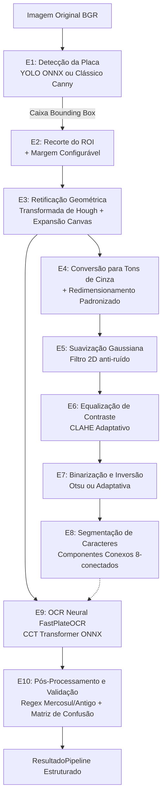

# AGENTS.md — Contexto do Sistema ALPR Didático

> Guia de referência operacional, arquitetural e técnico para agentes autônomos e desenvolvedores que atuam no repositório **alpr-placas**.

---

## 1. Visão Geral do Projeto

O **alpr-placas** é uma aplicação desktop offline e didática para **Reconhecimento Automático de Placas Veiculares (ALPR — *Automatic License Plate Recognition*)**, desenvolvida em Python 3.12 com interface gráfica em PySide6 (Qt 6) e inferência neural baseada em ONNX Runtime (CPU).

### Objetivos Centrais
- **Localização de Placas:** Suporte a dois métodos intercambiáveis:
  1. *Deep Learning:* Rede neural YOLOv8 exportada em formato **ONNX** executada com `onnxruntime` (CPU).
  2. *Processamento Clássico:* Visão computacional tradicional via detector de bordas Canny e filtragem geométrica de contornos quadriláteros.
- **Processamento de Imagem Transparente e Didático:** Exibição visual de cada etapa intermediária (bordas, recorte do ROI, equalização CLAHE, binarização por limiarização e segmentação de caracteres).
- **Tratamento Robusto de Inclinações e Fotos Diagonais:** Retificação angular baseada na Transformada Probabilística de Hough com ponderação quadrática por comprimento ($comprimento^2$), descartando traços inclinados de caracteres e aplicando expansão de tela sem corte de caracteres.
- **OCR Neural Autocontido (FastPlateOCR):** Reconhecimento de caracteres baseado em **Compact Convolutional Transformers (CCT-S v2)** executado em ONNX Runtime, com pós-processamento contextual para padrões brasileiros (Mercosul `AAA0A00` e Cinza/Antigo `AAA-0000`).
- **Operação 100% Offline:** Nenhuma dependência de APIs em nuvem para inferência ou OCR; modelos embutidos diretamente no aplicativo.

---

## 2. Stack Tecnológica e Ferramentas

| Componente | Tecnologia | Versão / Detalhes |
|---|---|---|
| **Linguagem** | Python | `3.12` gerenciado pelo [uv](https://docs.astral.sh/uv/) |
| **Interface Gráfica** | PySide6 | `>= 6.6.0` (Qt 6 com QSS customizado e Fusion) |
| **Processamento de Imagem** | OpenCV (`opencv-python-headless`) | `>= 4.8.0` |
| **Computação Vetorial** | NumPy | `>= 1.26.0, < 2.0.0` |
| **Inferência de Redes Neurais** | ONNX Runtime | `>= 1.16.0` (execução CPU ultra-otimizada) |
| **Motor de OCR** | FastPlateOCR (`fast-plate-ocr`) | `>= 1.1.0` (CCT Transformer ONNX local) |
| **Empacotador Desktop** | PyInstaller | `>= 6.10.0` (distribuição `.exe` Windows) |
| **Testes e Qualidade** | Pytest e Ruff | `pytest >= 8.0.0`, `ruff >= 0.3.0` |
| **Treinamento** | Ultralytics YOLOv8 / PyTorch | Executado no Google Colab (notebooks em `notebooks/`) |

---

## 3. Estrutura de Diretórios

```
algoritmoeprocessamentodeimagem/
├── AGENTS.md                  # Este documento (contexto mestre para agentes)
├── README.md                  # Apresentação do projeto e instruções de uso
├── pyproject.toml             # Metadados do projeto, dependências uv, ruff e pytest
├── uv.lock                    # Lockfile de dependências exatas
├── .python-version            # 3.12
│
├── .github/workflows/         # Automação CI/CD no GitHub Actions
│   ├── ci.yml                 # CI rápido com validação de código via Ruff Linter
│   └── release.yml            # Release automática via PyInstaller ao criar tag v*
│
├── docs/                      # Documentação técnica em Markdown
│   ├── 01-visao-geral.md      # Visão geral e contextualização didática
│   ├── 02-arquitetura.md      # Regras de arquitetura e isolamento de camadas
│   ├── 03-pipeline.md         # Detalhamento das etapas E1 a E10
│   ├── 04-interface.md        # Especificação da UI em PySide6
│   ├── 05-modelo-onnx.md      # Exportação, entrada e decodificação do YOLO
│   ├── 06-ocr-pos-processamento.md # Regras de validação e matrizes de substituição
│   ├── 07-dados-avaliacao.md  # Métricas e datasets (HuggingFace e IFRN)
│   ├── 08-setup-repositorio.md# Configuração do ambiente local
│   ├── 09-roadmap.md          # Próximos passos e backlog de melhorias
│   └── 10-riscos-etica.md     # Considerações éticas e LGPD
│
├── models/                    # Modelos neurais ONNX (ignorados no git se volumosos)
│   ├── placas.onnx            # Modelo YOLOv8 de detecção de placas veiculares
│   ├── ocr/                   # Modelo neural FastPlateOCR (CCT Transformer)
│   └── README.md
│
├── notebooks/                 # Notebooks Jupyter para treino e validação no Google Colab
│   ├── 02_treino_yolo.ipynb           # Treino base YOLOv8n com Parquet HuggingFace
│   ├── 02b_treino_yolo_brasil.ipynb   # Fine-tuning incremental com dataset brasileiro
│   └── 03_benchmark_comparativo.ipynb # Avaliação formal A/B, teste de estresse angular e gráficos
│
├── scripts/                   # Utilitários de automação e setup inicial
│   ├── baixar_modelo_referencia.py    # Download dos modelos ONNX pré-treinados
│   └── avaliar.py             # Benchmark quantitativo do dataset data/teste (120 amostras)
│
├── src/                       # Código-fonte principal da aplicação
│   ├── __init__.py
│   ├── app.py                 # Ponto de entrada (`python -m src.app`)
│   ├── config.py              # Dataclasses de configuração e caminhos congelados
│   ├── pipeline.py            # Orquestrador central que encadeia todas as etapas
│   ├── preprocessing.py       # Visão computacional pura (cinza, blur, CLAHE, Hough deskew)
│   ├── segmentation.py        # Segmentação de caracteres por componentes conexos
│   ├── ocr.py                 # Integração neural com FastPlateOCR (CCT Transformer ONNX)
│   ├── postprocess.py         # Regex de placas brasileiras e correção contextual
│   ├── utils.py               # Funções utilitárias (leitura de imagem, desenho de caixas)
│   │
│   ├── detection/             # Módulos de detecção de placas (E1)
│   │   ├── __init__.py
│   │   ├── contours.py        # Detecção geométrica clássica (Canny + contornos)
│   │   └── yolo_onnx.py       # Inferência ONNX, letterbox, decodificação e NMS
│   │
│   └── ui/                    # Camada de Apresentação (PySide6)
│       ├── __init__.py
│       ├── assets/            # Ícones do aplicativo (icone.ico, icone.png)
│       ├── janela_principal.py# Janela principal, layouts e coordenação de eventos
│       ├── painel_controles.py# Painel lateral com sliders, comboboxes e botões
│       ├── painel_imagem.py   # Viewports para exibição das imagens das etapas
│       ├── worker.py          # Execução assíncrona em thread separada (`QThread`)
│       ├── estilo.py          # Folha de estilos QSS (tema escuro profissional)
│       └── conversoes.py      # Conversão otimizada NumPy/OpenCV BGR/Gray -> QPixmap
│
└── tests/                     # Testes automatizados (Pytest)
    ├── test_nms.py            # Testes unitários do algoritmo NMS
    ├── test_ocr.py            # Testes do motor FastPlateOCR
    ├── test_preprocessing.py  # Testes de binarização, inversão, CLAHE e recortes
    ├── test_segmentation.py   # Testes de segmentação de caracteres
    └── test_postprocess.py    # Testes das regras de placas Mercosul, antigas e matriz de confusão
```

---

## 4. Arquitetura e Regras de Ouro para Agentes

```
┌────────────────────────────────────────────┐
│  UI (PySide6)                              │  janela, widgets, worker QThread, QPixmap
│  src/ui/                                   │
├────────────────────────────────────────────┤
│  Pipeline Orquestrador                     │  executar_pipeline(...) -> ResultadoPipeline
│  src/pipeline.py                           │
├────────────────────────────────────────────┤
│  Módulos de Processamento (Sem Qt)         │  detection/ · preprocessing · segmentation
│                                            │  ocr · postprocess · utils · config
├────────────────────────────────────────────┤
│  Infraestrutura Neural                     │  OpenCV · NumPy · ONNX Runtime (CPU)
└────────────────────────────────────────────┘
```

### Regras Mandatórias de Código:
1. **Regra de Dependência Unidirecional (Zero Qt no Core):**
   - Os módulos `src/detection/`, `src/preprocessing.py`, `src/segmentation.py`, `src/ocr.py`, `src/postprocess.py`, `src/config.py` e `src/pipeline.py` **NUNCA devem importar PySide6 ou Qt**.
   - Toda lógica nesses arquivos deve receber e retornar apenas tipos nativos de Python, `numpy.ndarray` ou dataclasses de `src/config.py`. Isso garante que o pipeline possa ser testado via CLI ou notebooks sem inicializar o loop de eventos gráfico.
2. **Execução Não-Bloqueante na UI:**
   - O processamento de imagens deve ser invocado exclusivamente através do `PipelineWorker` (`QThread` em `src/ui/worker.py`), emitindo o sinal `processamento_concluido(ResultadoPipeline)`. Nunca invoque `executar_pipeline` diretamente na thread principal da interface.
3. **Imutabilidade e Tipagem Estrita:**
   - O contrato de dados usa dataclasses imutáveis (`Caixa(frozen=True)`). Todas as funções devem ter *type hints* rigorosos e docstrings explicativas em português.
4. **Respeito ao Linteamento e Formatação:**
   - Linhas com limite de até 100 caracteres.
   - Sempre valide alterações com `uv run pytest` e `uv run ruff check src tests scripts`.

---

## 5. Fluxo de Execução do Pipeline (Etapas E1 a E10)



### Detalhes das Etapas Críticas:

- **E1 (Detecção):**
  - *YOLO:* `DetectorYolo` faz letterbox mantendo proporção (padrão $640 \times 640$), normalização para $[0, 1]$, inferência ONNX e decodificação com Non-Maximum Suppression (NMS).
  - *Clássico:* Gradiente morfológico / Canny, dilatação retangular e seleção de contornos quadriláteros com aspecto entre $2.0$ e $5.5$.
- **E3 (Correção Angular e Retificação):**
  - Implementado em `corrigir_inclinacao`. Usa `cv2.HoughLinesP` com limiar de comprimento estrutural ($\ge 26\%$ da largura) e ponderação quadrática ($comprimento^2$) para evitar falsas inclinações provocadas por traços diagonais de letras.
  - Recalcula a largura e altura do canvas ($W_{novo} = |H \sin \theta| + |W \cos \theta|$) para **não podar as extremidades da placa**.
- **E8 (Segmentação de Caracteres):**
  - `cv2.connectedComponentsWithStats` com conectividade 8. Filtra por faixa de altura proporcional, largura máxima e área mínima, ordenando da esquerda para a direita para exibição didática na interface.
- **E9 (OCR Neural com FastPlateOCR):**
  - Modelo CCT-S v2 (Compact Convolutional Transformer) executado via ONNX Runtime CPU. Alta robustez com taxa de acerto exato de 95,8% em recortes reais de placas.
- **E10 (Pós-processamento Posicional):**
  - Valida com regex se o texto limpo atende a:
    - **Mercosul:** `^[A-Z]{3}[0-9][A-Z][0-9]{2}$`
    - **Antigo:** `^[A-Z]{3}[0-9]{4}$`
  - Se houver pequenas ambiguidades típicas (ex: `O` por `0`, `S` por `5`, `G` por `6`, `B` por `8`), o algoritmo aplica correções posicionais contextuais (letras nas posições 0-2 e dígitos nas posições 3, 5 e 6).
  - Modo livre opcional para desativar a correção automática quando analisando placas estrangeiras.

---

## 6. Datasets e Treinamento de Modelos

A pasta `notebooks/` contém os fluxos de trabalho documentados para execução no Google Colab:

1. **`02_treino_yolo.ipynb`:**
   - Download do dataset público via Parquet do Hugging Face (`keremberke/license-plate-object-detection`).
   - Opção de **duplicação offline** com 4 variações fotométricas realistas.
   - Treinamento do YOLOv8n com *Data Augmentation* dinâmico na GPU (`degrees=25.0`, `shear=10.0`, `perspective=0.001`, `hsv_v=0.4`, `mosaic=1.0`).
   - Exportação direta para ONNX (`placas.onnx`).
2. **`02b_treino_yolo_brasil.ipynb`:**
   - Fine-tuning incremental especializado em placas brasileiras (dataset do IFRN).
3. **`03_benchmark_comparativo.ipynb`:**
   - Compara dois modelos (`modelo_a.pt` vs `modelo_b.pt` ou `.onnx`).
   - Calcula métricas formais COCO: Precisão, Revocação, mAP50, mAP50-95 e teste de estresse angular.

---

## 7. Guia de Comandos para Agentes

### Instalação e Execução
```bash
# Sincronizar ambiente virtual uv com dependências travadas
uv sync

# Baixar modelos de referência padrão ONNX (YOLO + FastPlateOCR)
uv run python scripts/baixar_modelo_referencia.py

# Iniciar aplicação desktop PySide6
uv run python -m src.app
```

### Qualidade de Código e Benchmark
```bash
# Executar suíte de testes automatizados
uv run pytest

# Executar linter e verificador de código (Ruff)
uv run ruff check src tests scripts

# Executar avaliação de benchmark completa sobre data/teste
uv run python scripts/avaliar.py
```

### Empacotamento Desktop (PyInstaller)
```bash
# Construir executável autônomo para Windows
uv run pyinstaller --noconsole --onefile --name "ALPR-Placas" --icon "src/ui/assets/icone.ico" --add-data "src/ui/assets;src/ui/assets" --add-data "models;models" --collect-all "fast_plate_ocr" --collect-all "onnxruntime" src/app.py
```

---

## 8. Convenções de Código e Estilo

- **Linguagem dos comentários e documentação:** Português do Brasil.
- **Tipagem:** Uso obrigatório de `from __future__ import annotations` e anotações de tipo em todas as assinaturas de funções e métodos.
- **Tratamento de exceções no Pipeline:** O pipeline nunca deve lançar uma exceção não capturada que derrube a UI; em vez disso, preencha o campo `erro: str | None` de `ResultadoPipeline`.
- **Caminhos de Arquivos:** Sempre utilizar `pathlib.Path` para manipulação de caminhos multiplataforma, respeitando `ROOT_DIR` que detecta dinamicamente `sys._MEIPASS` quando empacotado pelo PyInstaller.
- **Design da UI:** Manter a consistência visual em `src/ui/estilo.py`. A interface adota o tema Fusion profissional com tema claro calibrado, tipografia clara e controles com feedback de estado.
